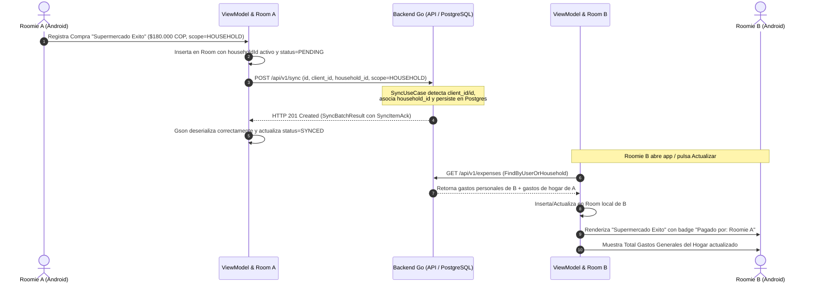

# Design Document: Sincronización Bidireccional Robusta y Vista Unificada de Gastos Generales del Hogar

## 1. Context & Problem Statement
El sistema permite a múltiples usuarios pertenecer al mismo hogar (`Household`), pero los gastos registrados por un integrante no se reflejan en el teléfono de los demás. La investigación en código reveló tres causas técnicas directas:

1. **Rechazo HTTP 400 en `POST /api/v1/sync`**:
   - `sync_usecase.go` definía `ClientID string json:"client_id" binding:"required"`.
   - Android enviaba `id` en `ExpenseSyncDto`. Gin fallaba la validación y rechazaba el lote completo.
2. **Crash de Gson en la Respuesta de Sincronización**:
   - El backend Go responde con `synced_expenses: [{"client_id": "...", "server_id": "...", "status": "SYNCED"}]`.
   - Android `SyncResponse` esperaba `List<String>`. Gson lanzaba `JsonSyntaxException`, impidiendo marcar los gastos locales como `SYNCED` y abortando la descarga remota subsecuente.
3. **Pérdida de `householdId` en la Capa Móvil**:
   - `ExpenseViewModel.createExpense` creaba `ExpenseEntity` omitiendo el parámetro `householdId`, por lo que se guardaba con `null` incluso si `scope == "HOUSEHOLD"`.
4. **Falta de Identificación Visual del Pagador**:
   - La interfaz no informaba quién realizó cada compra ni exhibía una tarjeta dedicada al **Total de Gastos Generales** acumulados de la casa.

---

## 2. Technical Architecture & Data Flow



---

## 3. Detailed Component Designs

### 3.1 Backend Go (`sync_usecase.go` y `sync_handler.go`)
- **Estructura Flexible en `SyncExpenseItem`**:
  ```go
  type SyncExpenseItem struct {
      ClientID      string                      `json:"client_id"`
      ID            string                      `json:"id"`
      Amount        float64                     `json:"amount" binding:"required,gt=0"`
      Date          time.Time                   `json:"date"`
      Category      string                      `json:"category" binding:"required"`
      Description   string                      `json:"description" binding:"required"`
      Scope         domain.ExpenseScope         `json:"scope"`
      PaymentStatus domain.ExpensePaymentStatus `json:"payment_status"`
  }
  ```
  - Resolución del ID: `expIDStr := expItem.ClientID; if expIDStr == "" { expIDStr = expItem.ID }`.
  - Si `expItem.Scope == domain.ExpenseScopeHousehold` y `user.ActiveHouseholdID != nil`, forzar `expense.HouseholdID = user.ActiveHouseholdID`.

### 3.2 Android Data Layer (`SyncBatchDto.kt` y `ExpenseRepository.kt`)
- **Adaptación de DTOs en `SyncBatchDto.kt`**:
  ```kotlin
  data class SyncItemAckDto(
      val client_id: String? = null,
      val server_id: String? = null,
      val status: String = "SYNCED",
      val error: String? = null
  )

  data class SyncResponse(
      val synced_expenses: List<SyncItemAckDto> = emptyList(),
      val synced_incomes: List<SyncItemAckDto> = emptyList(),
      val server_time: String = ""
  )
  ```
  - En `ExpenseSyncDto`: proveer tanto `id` como `client_id` anotados para asegurar total compatibilidad.
- **Sincronización en Corrutina en `ExpenseRepository.kt`**:
  - `performSync()` procesa los acks de `synced_expenses` verificando `client_id` o `server_id`.
  - Descarga los gastos mediante `api.listExpenses()` e inserta en Room vinculando `userId` y `householdId`.

### 3.3 Android Presentation Layer
- **`ExpenseViewModel.kt`**:
  - En `createExpense` y `updateExpense`, asignar explícitamente:
    `householdId = if (scope == "HOUSEHOLD") sessionManager.activeHouseholdId else null`.
  - Disparar `performSync()` de inmediato en `viewModelScope.launch` tras guardar el gasto.
- **`HouseholdScreen.kt`**:
  - **Tarjeta Total Gastos Generales**: Muestra el total consolidado de todas las transacciones compartidas del hogar.
  - **Lista de Gastos Generales con Pagador**:
    - Cada tarjeta de gasto muestra:
      - Título del gasto y monto en COP.
      - Chip del pagador:
        - Si `exp.userId == sessionManager.userId`: Chip verde "Pagado por: Tú".
        - Si no: Chip púrpura "Pagado por: [Nombre]". El nombre se resuelve dinámicamente desde `householdMembers.find { it.user_id == exp.userId }?.displayName`.
- **`ExpensesListScreen.kt`**:
  - En las tarjetas con ámbito `HOUSEHOLD`, mostrar el nombre del integrante pagador.
- **`DashboardScreen.kt`**:
  - En la tarjeta de resumen mensual, mostrar el desglose entre "Total Hogar" y "Mis Gastos".

---

## 4. Testing & Verification Plan
- **Backend Tests (`go test ./...`)**:
  - Validar que `SyncBatch` acepte ítems con clave `id` (sin `client_id`).
  - Validar que gastos de hogar se asocien al `ActiveHouseholdID` del usuario.
- **Manual Verification**:
  - Conectar teléfono físico con `adb reverse tcp:8080 tcp:8080`.
  - Registrar un gasto de hogar como Usuario 1 -> Verificar que se marque `SYNCED` inmediatamente.
  - Iniciar sesión como Usuario 2 -> Verificar que el gasto de Usuario 1 aparece en su lista con el badge "Pagado por: Usuario 1" y que el Total General del Hogar coincide.
