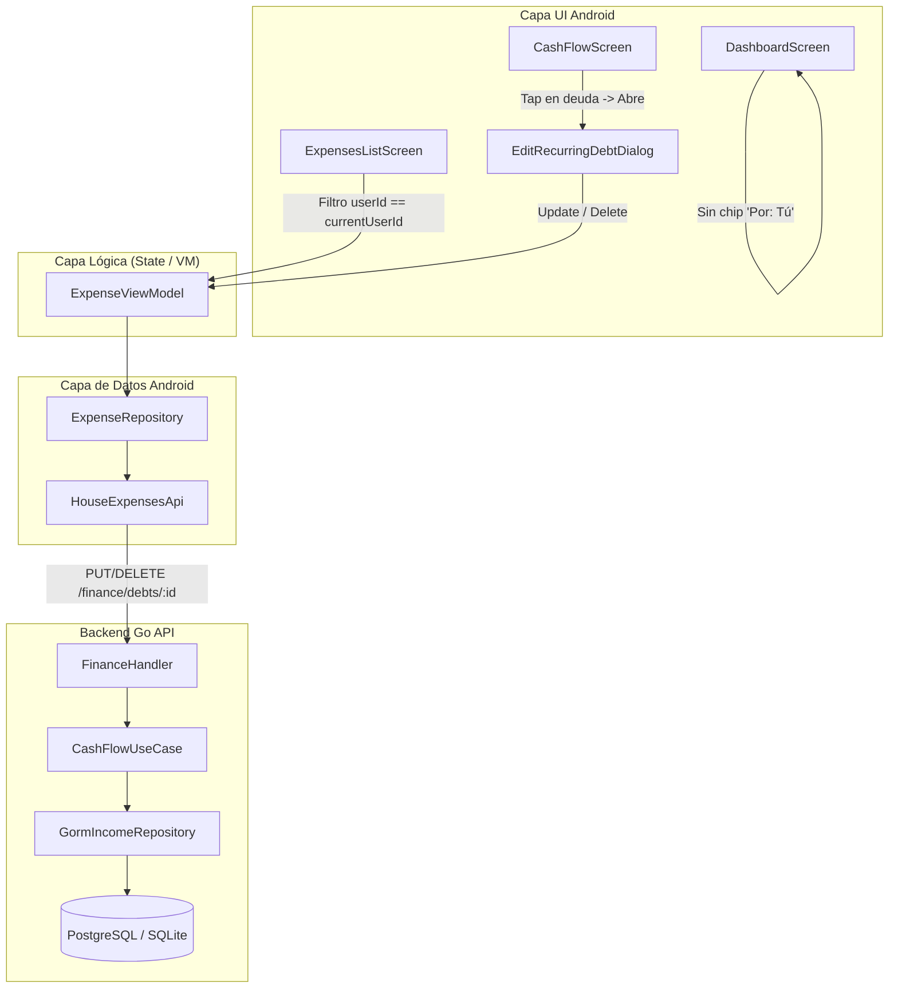

# Design Document: Aislamiento de Gastos Propios en Dashboard/Historial y CRUD de Compromisos Recurrentes

## 1. Arquitectura y Componentes Afectados



---

## 2. Detalle de Cambios por Componente

### A. Pantalla de Inicio (`DashboardScreen.kt`)
- **Problema actual**: En *"Transacciones del Mes"*, los gastos del hogar muestran un badge secundario `Surface(text = "Por: Tú")`.
- **Modificación**:
  - En la tarjeta de cada gasto dentro de *"Transacciones del Mes"*, remover el bloque condicional que renderiza `"Por: Tú"` o `"Por: $payerName"`.
  - La fila descriptiva queda simplificada a:
    1. Badge de Ámbito: `"Hogar"` (morado) o `"Personal"` (verde esmeralda).
    2. Categoría: `exp.category`.
    3. Fecha: `• ${exp.date.take(10)}`.
  - Esto elimina redundancias visuales y aclara que todas las transacciones listadas son las ejecutadas por el usuario.

### B. Historial de Gastos (`ExpensesListScreen.kt`)
- **Problema actual**: La consulta a SQLite devuelve todas las entidades `ExpenseEntity`, por lo que las compras de otros roomies sincronizadas aparecen en el historial del usuario.
- **Modificación**:
  - Obtener el identificador del usuario en sesión:
    ```kotlin
    val currentUserId = viewModel.sessionManager.userId
    ```
  - En la función de filtrado `filteredExpenses`:
    ```kotlin
    val matchesUser = exp.userId.isBlank() || exp.userId == currentUserId
    ```
    (Se añade `matchesUser` a las condiciones lógicas de inclusión).
  - Al aislar `filteredExpenses`, las variables derivadas (`sortedExpenses`, `pagedExpenses`, `groupedExpenses`, `totalFilteredAmount` y el contador de resultados) automáticamente reflejan **únicamente** los gastos del usuario autenticado.
  - En la tarjeta de gasto del historial (`ExpensesListScreen.kt`), remover el badge secundario de autoría `"Por: Tú"` / `"Por: $payerName"`, dejando únicamente el badge de ámbito, categoría y fecha.

### C. Backend Go: Endpoints de Edición y Eliminación de Deudas
1. **Puerto del Repositorio (`internal/core/ports/repositories.go`)**:
   ```go
   type IncomeRepository interface {
       // ... métodos existentes ...
       FindDebtByID(ctx context.Context, id uuid.UUID) (*domain.RecurringDebt, error)
       UpdateDebt(ctx context.Context, debt *domain.RecurringDebt) error
       DeleteDebt(ctx context.Context, id uuid.UUID) error
   }
   ```

2. **Adaptador GORM (`internal/adapters/repository/income_repository.go`)**:
   - `FindDebtByID`: `r.db.WithContext(ctx).First(&debt, "id = ?", id).Error`
   - `UpdateDebt`: `r.db.WithContext(ctx).Save(debt).Error`
   - `DeleteDebt`: `r.db.WithContext(ctx).Delete(&domain.RecurringDebt{}, "id = ?", id).Error`

3. **Caso de Uso (`internal/core/usecase/cashflow_usecase.go`)**:
   - DTO de entrada:
     ```go
     type UpdateDebtInput struct {
         Name                  string              `json:"name" binding:"required"`
         MonthlyAmount         float64             `json:"monthly_amount" binding:"required,gt=0"`
         DueDay                int                 `json:"due_day" binding:"required,min=1,max=31"`
         RemainingInstallments int                 `json:"remaining_installments"`
         Scope                 domain.ExpenseScope `json:"scope"`
     }
     ```
   - `UpdateDebt(ctx, userID, debtID, input)`:
     - Busca la deuda existente por ID.
     - Valida que `debt.UserID == userID` (evita que un usuario altere deudas ajenas). Si no coincide, retorna error de autorización.
     - Actualiza campos y persiste mediante `incomeRepo.UpdateDebt`.
   - `DeleteDebt(ctx, userID, debtID)`:
     - Busca la deuda por ID y valida propiedad (`debt.UserID == userID`).
     - Invoca `incomeRepo.DeleteDebt`.

4. **Handler HTTP (`internal/adapters/handlers/finance_handler.go`)**:
   - Registrar en `finance := rg.Group("/finance")`:
     ```go
     finance.PUT("/debts/:id", h.UpdateDebt)
     finance.DELETE("/debts/:id", h.DeleteDebt)
     ```
   - `UpdateDebt`: parsea `debtID` de la URL, valida JSON y llama a `cashFlowUC.UpdateDebt`.
   - `DeleteDebt`: parsea `debtID` de la URL y llama a `cashFlowUC.DeleteDebt`.

### D. Cliente Android: Gestión de Compromisos en Flujo de Caja
1. **API Retrofit (`HouseExpensesApi.kt`)**:
   ```kotlin
   @PUT("finance/debts/{id}")
   suspend fun updateDebt(
       @Path("id") id: String,
       @Body request: CreateDebtRequestDto
   ): Response<RecurringDebtDto>

   @DELETE("finance/debts/{id}")
   suspend fun deleteDebt(
       @Path("id") id: String
   ): Response<Map<String, String>>
   ```

2. **Repositorio (`ExpenseRepository.kt`)**:
   - `updateRecurringDebt(id, name, monthlyAmount, dueDay, scope, remainingInstallments)`
   - `deleteRecurringDebt(id)`

3. **ViewModel (`ExpenseViewModel.kt`)**:
   - `updateRecurringDebt(...)`: ejecuta llamada en corrutina, refresca `loadRecurringDebts()` y notifica `onSuccess` o `onError`.
   - `deleteRecurringDebt(...)`: ejecuta eliminación en corrutina, refresca `loadRecurringDebts()` y notifica `onSuccess` o `onError`.

4. **Interfaz (`CashFlowScreen.kt`)**:
   - Estado para la deuda en edición: `var debtToEdit by remember { mutableStateOf<RecurringDebtDto?>(null) }`.
   - Tarjetas en la lista de *"Compromisos Recurrentes y Suscripciones"*:
     - Agregar `onClick = { debtToEdit = debt }`.
     - Añadir sutil texto de ayuda en el encabezado: `"Toca para editar o eliminar"`.
   - Crear diálogo `EditRecurringDebtDialog`:
     - Campos prellenados con los valores actuales: Nombre, Monto mensual (con formato COP), Día límite de pago (1-31) y Selector de Ámbito (Personal / Hogar).
     - Botón "Guardar Cambios" -> ejecuta `viewModel.updateRecurringDebt(...)`.
     - Botón "Eliminar Compromiso" con confirmación -> ejecuta `viewModel.deleteRecurringDebt(...)`.
     - Botón "Cancelar".
