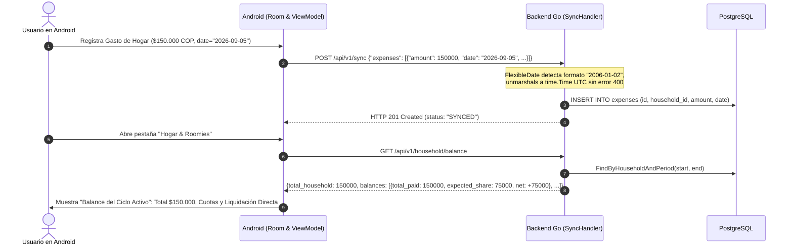

# Design Document: Balance del Ciclo Hogar, Deserialización Resiliente de Fechas y Liquidación Directa

## 1. Context & Problem Statement

En la arquitectura actual entre el backend Go y la aplicación Android se identificaron las siguientes causas de inconsistencia:

1. **Rechazo de Sincronización por Formato de Fecha**:
   - Android almacena y envía el campo `date` en formato `"yyyy-MM-dd"` (ejemplo: `"2026-09-05"`).
   - En el backend Go, `SyncExpenseItem` utiliza `Date time.Time`. La función `json.Unmarshal` de la librería estándar de Go rechaza cualquier string que no coincida con RFC3339 (`"2006-01-02T15:04:05Z07:00"`).
   - Gin falla con error HTTP `400 Bad Request`.
   - Los gastos nunca llegan a la base de datos PostgreSQL, provocando que `GET /api/v1/household/balance` devuelva `$ 0 COP` en `total_household` y en los aportes de cada integrante.

2. **Diseño Visual Sobrecargado**:
   - La inserción de una tarjeta separada de "Total Gastos Generales" duplicó visualmente información que corresponde al **Balance del Ciclo**.
   - En la pantalla de inicio (`DashboardScreen.kt`), la inclusión de columnas con totales dispares generó confusión en lugar de valor.
   - En `SettlementPaymentDialog`, la lista de medios de pago contenía nombres de bancos en lugar de los métodos genéricos solicitados ("Transferencia" y "Efectivo").

---

## 2. Technical Architecture & Data Flow



---

## 3. Detailed Component Designs

### 3.1 Backend Go (`sync_usecase.go` y `sync_usecase_test.go`)
- **Tipo de Fecha Tolerante (`FlexibleDate`)**:
  ```go
  type FlexibleDate struct {
      time.Time
  }

  func (fd *FlexibleDate) UnmarshalJSON(b []byte) error {
      s := strings.Trim(string(b), `"`)
      if s == "" || s == "null" {
          fd.Time = time.Time{}
          return nil
      }
      formats := []string{
          "2006-01-02",
          time.RFC3339,
          "2006-01-02T15:04:05",
          "2006-01-02 15:04:05",
      }
      for _, f := range formats {
          if t, err := time.Parse(f, s); err == nil {
              fd.Time = t.UTC()
              return nil
          }
      }
      return fmt.Errorf("formato de fecha no soportado: %s", s)
  }
  ```
- Reemplazar en `SyncExpenseItem` y `SyncIncomeItem` el tipo `Date time.Time` por `Date FlexibleDate`.
- En `sync_usecase_test.go`, validar explícitamente el envío de fechas en formato `"2006-01-02"`.

### 3.2 Backend Go (`expense_usecase.go`): Liquidación Explicita
- En `CalculateHouseholdBalance`:
  - Formular el texto `settlement` con claridad indicando exactamente el destinatario del dinero:
    - *"Debes pagar $X a [Nombre de Roomie]."*
    - *"[Nombre de Roomie] debe pagarte $X a ti."*
    - Si las cuentas están saldadas: *"Las cuentas están equilibradas. ¡Nadie se debe nada!"*

### 3.3 Android Presentation Layer (`HouseholdScreen.kt`)
- **Eliminar la Tarjeta Externa**: Remover por completo el bloque `// Tarjeta Destacada: Total Gastos Generales del Hogar` (líneas 971-1027).
- **Consolidar en "Balance del Ciclo Activo" (Tarjeta 4)**:
  - Header: `"Balance del Ciclo Activo"` y periodo de fechas.
  - Gran cifra central: `"TOTAL GASTOS DEL HOGAR"` en COP.
    - Soporte de resiliencia: Si `balance?.total_household` es 0 pero hay gastos locales del hogar, computar la suma en caliente de `householdExpenses.sumOf { it.amount }`.
  - Sección `"Aportes y Cuotas por Integrante"`:
    - Mostrar para cada miembro:
      - Nombre (con indicador `"(Tú)"` si aplica).
      - Texto descriptivo: `"Pagó: $X • Cuota: $Y (Z%)"`.
      - Badge neto: `"+$X a favor"`, `"-$X debe"` o `"Al día"`.
  - Caja `"LIQUIDACIÓN SUGERIDA"`:
    - Destacar con claridad el mensaje directo de a quién transferir el dinero para cuadrar las cuentas.
- **Simplificar `SettlementPaymentDialog`**:
  - Cambiar `val channels = listOf("Nequi", "Daviplata", "Bancolombia", "Efectivo")` por:
    `val channels = listOf("Transferencia", "Efectivo")`.

### 3.4 Android Presentation Layer (`DashboardScreen.kt`)
- **Eliminar Subdivisión Innecesaria**:
  - Retirar el `HorizontalDivider` y el `Row` con `"Total General Hogar"` y `"Mis Gastos Personales"` de la tarjeta superior de gastos del mes.
  - La tarjeta mensual mostrará únicamente el total del mes del usuario y el estado de sincronización, tal como fue concebida.
  - El balance 50/50 del hogar permanecerá en su tarjeta dedicada de balance del hogar.

---

## 4. Verification Plan

1. **Pruebas Unitarias en Backend Go (`go test ./...`)**:
   - Validar que un batch con `"date": "2026-09-05"` se deserialice y persista sin errores.
   - Validar que `CalculateHouseholdBalance` genere liquidaciones precisas con los nombres de acreedor y deudor.
2. **Pruebas de Interfaz en Android**:
   - Verificar en `HouseholdScreen.kt` que no exista la tarjeta duplicada.
   - Comprobar que en el Balance del Ciclo se aprecie el total acumulado, las cuotas por integrante y la liquidación directa.
   - Comprobar que el modal de pago solo ofrezca "Transferencia" o "Efectivo".
   - Verificar en `DashboardScreen.kt` que la tarjeta superior no contenga la fila adicional de métricas erróneas.
